# architecture-beta

`architecture-beta` draws groups, services, port arrows and icons. The
approved body, `architecture.mmd`, verbatim:

```mermaid
architecture-beta
  group lab(cloud)[Local lab]
  group gpu(server)[Local GPU] in lab

  service agent(logos:claude-icon)[Agent] in lab
  service toml(disk)[Piece toml] in lab
  service voice(mdi:microphone)[VoiceStudio] in gpu
  service comfy(mdi:image-filter-hdr)[ComfyUI] in gpu
  service output(database)[WAV and PNG] in lab
  junction dispatch in lab

  agent:R --> L:toml
  toml:R -- L:dispatch
  dispatch:R --> L:voice
  dispatch:B --> L:comfy
  voice:R --> L:output
```

## Ports

Every arrow leaves and enters through a port: `L`, `R`, `T`, `B` (left,
right, top, bottom). Write the source as `service:PORT` and the destination
as `PORT:service`, separated by `-->` for a directed arrow or `--` for a
plain line.

## Icons

Built-in icons: `cloud`, `database`, `disk`, `internet`, `server`.

Every render passes `--iconPacksNamesAndUrls`, so Iconify is loaded too:
`logos:<marca>` (for example `logos:docker-icon`) and `mdi:<icono>`
(Material, for example `mdi:microphone`).

## Junctions

A `junction` splits one exit into several arrows without an extra box. In
`architecture.mmd`, `dispatch` is the junction: `toml:R -- L:dispatch` feeds
it, then `dispatch:R --> L:voice` and `dispatch:B --> L:comfy` fan out.

## The B-port trap

An arrow that leaves from the bottom (`B`) crosses the service's label. Split
the exit through a `junction` instead of drawing the `B` arrow from the
service itself, as `dispatch` does above.
